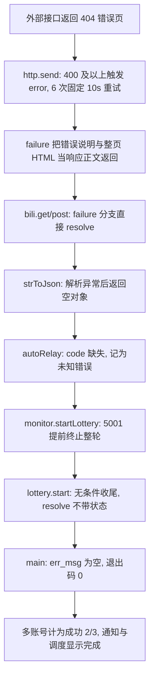

## 用户要求

根据 2026-11-03、2026-11-04 两份运行日志，判断此项目的弱点。

## 产品概述

产出一份可追溯、可复核的弱点诊断报告：以两天日志中的实际表现为证据，结合项目实现定位根因，按严重程度分级呈现每条弱点的现象、成因、影响范围与改进方向，并给出优先级建议。报告需明确区分「稳定复现的缺陷」与「仅单日出现的偶发或新增问题」，并区分「外部服务异常」与「项目自身处理不当」。

## 核心功能

- 两日日志证据结构化：错误时间线、重试行为、参与数量与「完成」结论的对照表
- 弱点分级清单：按 P0／P1／P2 排序，每条含日志证据、根因链路、影响范围
- 结果可信度评估：实际零产出却整体报成功的矛盾点及其造成的判断失灵
- 稳定性与容错评估：重试策略、备用线路、外部依赖变更时的应对能力
- 可观测性评估：日志噪音、级别使用、通知告警与统计口径准确性
- 健壮性与成本评估：内容解析容错、筛选覆盖度、无效运行开销、账号行为风险
- 分级改进建议与验收要点，供后续按优先级逐项落地

## 任务定位与边界

本任务为**诊断交付**：首要产物是一份弱点分析报告，本次不修改生产代码。计划中固化已验证的栈、根因链路与改造约束，保证报告每条结论可复核；代码加固作为报告产出的优先级建议，需另行确认后实施。

## 技术栈核对（只读确认）

- Node.js 20.20.2，项目版本 2.11.2，CommonJS 模块，入口 `main.js`（`node main.js start`）
- 网络层为原生 `http`／`https` 封装，日志用 `chalk` 着色；依赖 `chalk`、`http-proxy-agent`、`https-proxy-agent`、`nodemailer`、`@catlair/blogin`；开发依赖 `eslint`、`pkg`
- 无第三方测试框架：`test/index.js` 设置 `log._level = 4` 后自动载入 `*.test.js`；另有 `test:opus`（`test/opus_cycle_guard.js`）、`test:multi`（两个多账号脚本）、`lint` 脚本
- 配置由 `env.js`、`my_config.js` 加载，示例为 `env.example.js`、`my_config.example.js`

## 弱点根因链路（已验证）

- **失败被伪装成数据**：`lib/net/http.js` 的 `send()`(67-149) 仅在状态码小于 400 时走 `success`，400 及以上用 `res.emit('error')` 转入同一错误监听；重试耗尽后 `failure()`(125) 把「错误说明＋整页 404 HTML」当作响应正文返回；`lib/net/bili.js` 的 `get()`(89-105)／`post()`(112-130) 在 `failure` 分支直接 `resolve`；`lib/utils.js` 的 `strToJson()`(41-56) 捕获 `JSON.parse` 异常后返回空对象，异常被吞。
- **业务层误判并提前终止**：`lib/net/bili.js` 的 `autoRelay()`(857-897) 因 `res.code` 缺失落入 `default` 记「未知错误」；`lib/core/monitor.js` 的 `startLottery()`(104-255) 将 5001 视为整轮终止；`lib/lottery.js` 的 `start()`(34-72) 中 `Turn_off_the_Monitor` 无条件执行收尾且 `resolve()` 不带状态；`main.js` 顶层 IIFE(453-493) 在 `err_msg` 为空时 `process.exit(0)`，且第 481 行非子进程即使有错也退出 0。
- **统计口径失真**：`main.js` 的 `runAccountsAsChildProcess()`(136-198) 以子进程退出码 0 计成功、被跳过的无 COOKIE 账号仍占分母、只要有一个成功就返回空串；`lib/helper/randomDynamic.js`(10-41) 丢弃 `shareVideo()` 返回值（`lib/net/bili.js` 1000-1026 在失败分支仍返回 `true`）。
- **其余已定位点**：`http.js`(49-57) 为 6 次固定 10 秒重试、无退避与错误分类；`lib/net/bili.js` 的 `Line.run()`(57-81) 单线路空转且返回失败占位值不抛错；`monitor.js` 的 `filterLotteryInfo()`(468-485) 未剥离代码块围栏；`lib/core/searcher.js` 的 `isOpusCollectionDynamic()`(226-278) 用正则扫整页 HTML；`lib/utils.js` 的 `debug/warn/error`(250-313) 无长度截断且写入 `_cache`（上限 20000），脏数据会进入通知正文。



## 实现要点与执行注意事项

- **可追溯性**：报告每条结论必须同时给出日志行号与源码文件／函数／行号；两天日志结构相近，需逐条对齐而非合并描述。
- **归因边界**：404 是上游现象，项目弱点在于错误传播、重试、线路降级、告警与统计的处理；不得把外部失效直接当作项目缺陷结论，也不得忽略项目对失效的放大。
- **两日差异**：11-03 独有「4101139／切换线路 1/1／所有备用线路均连接失败／AI 返回代码块围栏」，11-04 独有「Opus type=64 从 HTML 提取链接／无关键词动态」；稳定复现项为每账号各两次的 404、json 解析错误、转发失败、零参与、成功 2/3。
- **量化成本**：固定重试 6×10s，两天共 8 次约 8 分钟；单次运行 18～25 分钟但参与数为 0；404 HTML 约占日志 50% 以上（11-03 约 1200/2349 行、11-04 约 800/1953 行）。
- **日志与告警**：后续加固须限制响应体写入日志与 `_cache` 的长度、纠正级别误用（如「当前已是最新版本」用 Warn）、并区分「进程退出成功」与「业务实际参与数」两套指标。
- **影响范围控制**：本次只读分析与新增文档，零生产代码改动；后续加固须保持中文日志风格、`env.js`／`my_config.js` 兼容、不引入新依赖，优先针对性小改动并以配置开关提供回退，避免重构 `lib/net/bili.js` 等大文件。

## 目录结构

本次仅新增一份报告文档；其余文件为只读分析对象（受影响但不修改）。

```
e:/Project/LotteryAutoScript/
├── doc/
│   └── 弱点分析-2026-11.md              # [NEW] 弱点诊断报告。含两日日志证据表、根因链路图、P0/P1/P2 分级清单、每条弱点的现象/成因/影响/改进方向、成本量化、验收要点与后续加固优先级；每条结论标注日志行号与源码位置。
├── 2026-11-03-12-00-00-075.log         # [只读] 第一份日志证据源，2349 行，耗时 1504 秒。
├── 2026-11-04-12-00-00-084.log         # [只读] 第二份日志证据源，1953 行，耗时 1110 秒。
├── lib/net/http.js                      # [只读·受影响] 请求封装与重试策略，核对 6 次固定等待、状态码判定、错误字符串返回。
├── lib/net/bili.js                      # [只读·受影响] 接口调用、Line 备用线路、autoRelay、getAttentionList、shareVideo 的失败处理。
├── lib/net/api.bili.js                  # [只读·受影响] 硬编码接口路径与第三方线路，评估上游变更的耦合风险。
├── lib/utils.js                         # [只读·受影响] strToJson、getAiContent、日志输出与 _cache，核对异常吞没与日志噪音。
├── lib/core/monitor.js                  # [只读·受影响] 抽奖循环、终止条件、AI 判断与关注列表兜底。
├── lib/core/searcher.js                 # [只读·受影响] Opus 合集检测与 HTML 正则解析的脆弱性。
├── lib/lottery.js                       # [只读·受影响] 事件收尾与无条件 resolve 的状态丢失。
├── lib/helper/randomDynamic.js          # [只读·受影响] 抽奖终止后仍执行的写操作与返回值丢弃。
├── main.js                              # [只读·受影响] 多账号计数、成功统计与退出码逻辑。
├── test/index.js                        # [只读] 测试入口，用于给出后续加固的验证方式建议。
└── package.json                         # [只读] 脚本清单，确认 test/test:multi/test:opus/lint 验证途径。
```

## SubAgent

- **code-explorer**
- Purpose: 复核两份日志中每一类异常在源码中的完整根因链路，补全并校正文件、函数与行号定位，特别核对错误传播、退出码、统计口径与日志缓存四处。
- Expected outcome: 产出一份「日志现象 → 源码位置 → 代码缺陷」的可追溯清单，确保报告中每条弱点结论都有源码依据且无臆测。