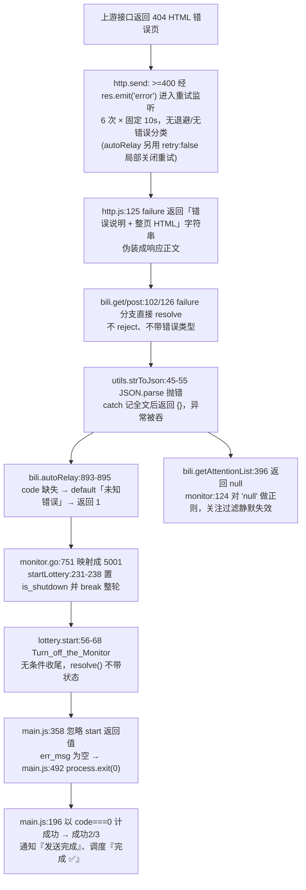

# 弱点诊断报告：2026-11-03 / 2026-11-04 运行日志

> 版本基线：`v2.11.2` / `Nodejs v20.20.2` / CommonJS / 入口 `node main.js start`
> 运行形态：3 账号、独立子进程模式（`[多账号] 执行模式: 独立子进程`）
> 报告性质：**诊断交付**。本次只新增本文档，**不修改任何生产代码**；代码加固列为优先级建议，需另行确认后实施。
>
> **时效性提示（2026-11-05 补充）**：本报告是**改动前的诊断快照**（基线 v2.11.2）。报告完成后已实施通知/日志容错改动（HTML 错误页折叠为「遇到页面错误」、日志与通知正文限长），并合并上游 `v2.11.3`（`accfb8b`，合并提交 `4756c27`）：`FEED_GET_ATTENTION_LIST`、`DYNAMIC_REPOST_REPOST` 两个返回 404 的旧接口被删除，替换为 `RELATION_FOLLOWINGS`（分页读取关注列表）与 `DYNAMIC_CREATE`（JSON 富文本转发），`Monitor` 也在关注列表获取失败时直接终止。因此 P1-2 的「两接口持续 404」对合并后版本已不成立、P2-1 的「日志/通知无长度截断」已修复；P0 的失败传播与统计口径、P1 的重试/线路/终止粒度等分析仍对应改动前代码，作为历史诊断有效。

---

## 0. 报告说明与计划项对照

### 0.1 证据来源与复核方式

| 项 | 说明 |
| --- | --- |
| 日志 A | `2026-11-03-12-00-00-075.log`，2561 行，12:00:00 → 12:25:04，耗时 1504 秒 |
| 日志 B | `2026-11-04-12-00-00-084.log`，2173 行，12:00:00 → 12:18:30，耗时 1110 秒 |
| 日志行号 | 均指上述两个文件的物理行号；可用 `Select-String -LiteralPath <绝对路径>` 复现 |
| 源码行号 | 指当前工作区源码的物理行号；已用只读探索 + 抽样阅读交叉核验 |
| 注意 | 仓库 `.gitignore:9` 忽略 `*.log`，全文检索工具默认搜不到日志；本报告按**绝对路径直接读取**取得行号，未受忽略规则影响 |

复核报告任一行号的最小命令（PowerShell，显式 UTF8 避免编码问题）：

```powershell
$f = 'e:/Project/LotteryAutoScript/2026-11-04-12-00-00-084.log'
Select-String -LiteralPath $f -Pattern '^\[20\d{2}-|\[不期待响应\]' |
    ForEach-Object { "$($_.LineNumber): $($_.Line)" }
```

### 0.2 计划项 → 报告章节对照（每处产物对应哪个计划项、目的）

| 计划项 | 报告章节 | 目的 |
| --- | --- | --- |
| `collect-log-evidence` 汇总两日错误时间线与统计口径证据表 | §1 执行摘要、§2 证据基线、§8 附录 | 把"零产出却报成功"量化成可对照的行号证据，两日逐条对齐而非合并描述 |
| `verify-root-cause` 复核源码根因链路 | §3 根因链路、§9 校正说明 | 每条结论给出源码文件/函数/行号，并修正既有定位中的偏差 |
| `grade-weaknesses` 交叉对比两日差异、按 P0/P1/P2 分级 | §2.3 稳定复现与两日差异、§4 分级清单、§5 归因边界 | 区分稳定缺陷与偶发现象，区分上游异常与项目自身处理不当 |
| `write-weakness-report` 撰写弱点分析报告 | 全文 | 输出可追溯、可复核的诊断结论与改进方向 |
| `review-report` 复核结论并补充验收要点 | §6 改进优先级、§7 验证要点、§9 校正说明 | 保证结论与日志行、源码位置一致，并给出可执行的验收方式 |

### 0.3 术语约定

- **业务成功**：实际"成功参与抽奖数 > 0"。
- **进程成功**：`err_msg` 为空 → `process.exit(0)`（子进程 `code === 0`）。
- 两日日志中，两者**完全背离**：业务成功为 0，进程成功为 2/2。

---

## 1. 执行摘要

**结论：两天共 4 次账号运行，累计成功参与 0 个抽奖，但每次都自报"成功"，调度层显示"完成 ✅"。**

- 稳定复现：每个账号在「获取关注列表」与「转发动态」两个环节各拿到一次 B 站 404 HTML 错误页，触发 `json解析` 异常 → `转发动态 未知错误` → `结束抽奖 原因: 转发失败` → `本轮共处理1条,成功参与0条`。
- 失败之后，脚本仍继续生成随机动态、发送通知、转发视频，最终 `所有账号执行完毕(成功2/3)`、`## 完成 ✅`。
- 根因不是 404 本身，而是一条完整的**"失败被伪装成数据 → 异常被吞 → 业务静默终止 → 进程 exit(0)"**链路，配合对上游接口的强耦合、无退避重试和失真统计口径，使连续两天全量失效却无从察觉。
- 结论可信度：高。同一模式在两日、4 个账号、8 组 404 上完全复现，且源码链路逐环闭合（§3）。

**最优先修复**：让"业务失败"能反映到 Promise 状态、退出码与通知（P0-1、P0-2）；其次让 4xx 不再重试 60 秒、让单接口失效不终止整轮（P1）。

---

## 2. 证据基线

### 2.1 运行概况对照表

| 指标 | 2026-11-03 | 2026-11-04 |
| --- | --- | --- |
| 日志行数 / 结束行 | 2561 / L2561 | 2173 / L2173 |
| 起止 / 耗时 | 12:00:00 → 12:25:04 / 1504s | 12:00:00 → 12:18:30 / 1110s |
| 账号 | 3（第 3 个未配置 COOKIE 被跳过，L2555） | 3（同，L2167） |
| 404 事件组数 / HTML 页 / HTML 行数 | 4 组 / 8 页 / 1576 行（占 61.5%） | 4 组 / 8 页 / 1576 行（占 72.5%） |
| 「获取关注列表 失败」次数 | 2（L241、L1508） | 2（L241、L1304） |
| 「转发动态 未知错误」次数 | 2（L1071、L2334） | 2（L867、L1946） |
| 本轮处理 / 成功参与 | 1 / 0（L1275、L2538） | 1 / 0（L1071、L2150） |
| 本次运行共参与 | 0（L1278、L2541） | 0（L1074、L2153） |
| 结束抽奖原因 | 转发失败（L1277、L2540） | 转发失败（L1073、L2152） |
| 通知 / 转发视频 | 均"发送完成"/"成功转发"（L1282/L1288、L2548/L2551） | 均"发送完成"/"成功转发"（L1081/L1084、L2160/L2163） |
| 对外结论 | `成功2/3`（L2558）、`完成 ✅`（L2561） | `成功2/3`（L2170）、`完成 ✅`（L2173） |

### 2.2 404 事件逐条对齐（每日 4 组，每组两次打印同一响应）

| 组 | 账号 / 环节 | 11-03 行号（时间） | 11-04 行号（时间） |
| --- | --- | --- | --- |
| 1 | 帐号1 获取关注列表 | 重试 L34-39；`json解析` L40（HTML L43-239）；`获取关注列表 失败` L241（HTML L244-440）；12:00:01 → 12:01:02 | 重试 L34-39；`json解析` L40（HTML L43-239）；`获取关注列表 失败` L241（HTML L244-440）；12:00:01 → 12:01:02 |
| 2 | 帐号1 转发动态 | 无重试（`retry:false`）；`json解析` L870（HTML L873-1069）；`转发动态 未知错误` L1071（HTML L1074-1270）；12:10:57 | 无重试（`retry:false`）；`json解析` L666（HTML L669-865）；`转发动态 未知错误` L867（HTML L870-1066）；12:08:17 |
| 3 | 帐号2 获取关注列表 | 重试 L1301-1306；`json解析` L1307（HTML L1310-1506）；`获取关注列表 失败` L1508（HTML L1511-1707）；12:12:01 → 12:13:01 | 重试 L1097-1102；`json解析` L1103（HTML L1106-1302）；`获取关注列表 失败` L1304（HTML L1307-1503）；12:09:20 → 12:10:21 |
| 4 | 帐号2 转发动态 | 无重试（`retry:false`）；`json解析` L2133（HTML L2136-2332）；`转发动态 未知错误` L2334（HTML L2337-2533）；12:24:01 | 无重试（`retry:false`）；`json解析` L1745（HTML L1748-1944）；`转发动态 未知错误` L1946（HTML L1949-2145）；12:17:27 |

重试行为**并非每组都有**：`获取关注列表` 使用默认配置，固定 6 行 `[不期待响应]原因:HTTP状态码: 404 尝试重新请求中...`（11-03 L34-39 / L1301-1306；11-04 L34-39 / L1097-1102），从首行到报错约 61 秒；`转发动态` 因 `lib/net/bili.js:866` 在 `autoRelay()` 中显式设置 `retry: false`，**不重试、无 `[不期待响应]` 行**，404 直接落到失败出口。两日 `[不期待响应]` 行合计 11-03 为 15 行、11-04 为 12 行，其中 11-03 L1710-1712 是另外 3 行 `HTTP状态码: 412`（风控限流），重试约 31 秒后 `搜索专栏` 成功（L1713）。**两日 8 组 404 完全一致**，说明是稳定的上游接口失效而非偶发抖动；412 则说明账号已触及风控阈值。

### 2.3 稳定复现项 vs 两日差异

| 分类 | 现象 | 11-03 | 11-04 |
| --- | --- | --- | --- |
| 稳定 | 每账号 2 次 404、8 个 HTML 页、`json解析` 异常、`转发失败`、零参与、`成功2/3` | ✔ | ✔ |
| 稳定 | 第 3 账号跳过（L2555 / L2167）、账号间 60000ms（L1291/L2554、L1087/L2166）、`未在my_config.js中设置休眠时间` | ✔ | ✔ |
| 稳定 | `当前已是最新版本` 用 `[Warn]`（L20）、`[时延] 8000ms` 串行、企业微信"发送通知消息完成" | ✔ | ✔ |
| 稳定 | `筛选动态 无关键词动态的描述` 用 `[Warn]` | L814、L2051（2 次） | L596、L1659、L1673、L1686（4 次） |
| 仅 11-03 | `code:500 Cannot read property 'only_fans' of undefined` / `4101139` / `切换线路(1/1)` / `所有备用线路均连接失败` / `连续失败1次` | L447-468 | — |
| 仅 11-03 | `ai判断抽奖 未返回JSON格式: ```json {"has_key_words":true} ``` ` | L2093-2097 | — |
| 仅 11-03 | `HTTP状态码: 412` 风控限流重试 3 次，约 31 秒后 `搜索专栏` 成功 | L1710-1713 | — |
| 稳定 | `获取关注列表` 固定 6 次重试；`转发动态` 因 `retry:false` 不重试 | L34-39 / L1301-1306；组2、组4 无重试行 | L34-39 / L1097-1102；组2、组4 无重试行 |
| 仅 11-04 | `Opus合集检测 ... type=64，尝试从Opus页面HTML中提取链接` | — | L449（含 301 重定向 L444/L451） |
| 仅 11-04 | `已转发过（前置跳过）`、`包含屏蔽词` | — | L454-458、L1735 |
| 数量变化 | 筛选完毕数量 48/48 → 30/28 | L864、L2124 | L658、L1736 |

> 校正：计划草稿把「无关键词动态」列为 11-04 独有，实际**两日均出现**，只是 11-04 次数更多；单日独有项应只保留 11-03 的线路/AI 围栏与 11-04 的 Opus 检测、前置跳过、屏蔽词。

### 2.4 量化成本

| 项 | 数值 | 依据 |
| --- | --- | --- |
| 固定重试 | `获取关注列表` 每次 404 = 6 次 × 10s 等待、最多 7 次请求；`转发动态` 因 `retry:false` 不重试 | `lib/net/http.js:51,57,119-123`、`lib/net/bili.js:866`；日志 12:00:01→12:01:02 |
| 两日重试浪费 | 4 次 404 重试 × 约 60s ≈ 4 分钟；另加 11-03 一次 412 重试约 31s，合计约 4.5 分钟 | 11-03 L34-39 / L1301-1306 / L1710-1713；11-04 L34-39 / L1097-1102 |
| 风控信号 | 11-03 出现 3 次 HTTP 412 后才成功 `搜索专栏` | L1710-1713 |
| 日志冗余 | 每日 1576 行是 404 HTML（8 页 × 约 197 行），占比 61.5% / 72.5% | HTML 行号区间见 §2.2 |
| 有效产出 | 1504s + 1110s ≈ 43.6 分钟运行，成功参与 0 | L2561、L2173 与 §2.1 |
| 写操作 | 每个账号在抽奖终止后仍执行评论/关注/点赞/随机动态/转发视频 | L1279-1288、L2542-2551、L1075-1084、L2154-2163 |

---

## 3. 根因链路（已逐环核验）



关键源码位置（全部只读核验）：

| 环节 | 位置 |
| --- | --- |
| 默认超时/等待/重试次数 | `lib/net/http.js:49` (20000)、`:51` (10000)、`:57` (6) |
| 状态码判定与错误注入 | `lib/net/http.js:129`（`<400` 成功）、`:132`（`>=400` 触发 `res.emit('error')`） |
| 重试与失败出口 | `lib/net/http.js:118-127`（响应错误，`:125` 带正文）、`:137-146`（网络错误，`:144` 不带正文） |
| 失败分支直接 resolve | `lib/net/bili.js:102` (`get`)、`:126` (`post`) |
| 解析吞异常 | `lib/utils.js:41-56`（`:48` 记全文、`:55` 返回 `{}`） |
| 业务误判 | `lib/net/bili.js:893-895` (`autoRelay`)、`:382-398` (`getAttentionList`) |
| 状态映射与终止 | `lib/core/monitor.js:739-751` (`go`)、`:231-238` (`startLottery`)、`:92-93` (`init`) |
| 无状态收尾 | `lib/lottery.js:56-69`（`sendNotify` 受 `:60` 配置控制；`createRandomDynamic`/`flush`/`resolve()` 无条件） |
| 退出码 | `main.js:358`、`:475-492`（`:481` 为有错分支：`is_child_process() ? 1 : 0`；`:492` 为空错误分支 `exit(0)`） |
| 统计口径 | `main.js:145-148`、`:177-179`、`:196-197`；同进程 `:290-294`、`:305`、`:318-321` |
| 日志/缓存 | `lib/utils.js:199,201,207-214,250-313`；`lib/helper/notify.js:232-269,647` |
| 接口常量 | `lib/net/api.bili.js:1-42`（40 个常量；`:9` `FEED_GET_ATTENTION_LIST`、`:4` `DYNAMIC_REPOST_REPOST`、`:5` `DYNAMIC_REPOST_SHARE`） |

> 补充：`main.js:481` 的"父进程有错也 exit(0)"是潜在弱点，但本次日志走子进程模式且 `err_msg` 根本未生成，故未触发；不得把它当成两日失败的直接原因。

---

## 4. 弱点分级清单

### P0-1 失败被伪装成数据，异常逐级吞没，最终判定为进程成功

- **现象**：8 组 404 全部产生 `json解析 SyntaxError`（首字符「响」）与 `未知错误`/`失败`，随后 `结束抽奖 原因: 转发失败`、`本轮共处理1条,成功参与0条`，却以 `成功2/3`、`完成 ✅` 收尾（§2.1、§2.2）。
- **成因**：`lib/net/http.js:125` 把错误说明＋整页 HTML 作为响应正文 → `lib/net/bili.js:102/126` `failure` 直接 `resolve` → `lib/utils.js:45-55` 解析失败返回 `{}` → `lib/net/bili.js:893-895` 落到 `default` → `lib/lottery.js:68` `resolve()` 不带状态 → `main.js:492` `exit(0)`。
- **影响范围**：所有账号、所有接口、所有抽奖轮次；**整个项目的失败可观测性归零**。
- **改进方向**：网络层用结构化错误对象（`{ok:false, httpStatus, body}`）或 `reject`；解析层不返回 `{}` 兜底；业务层把 `network/parse error` 与业务 `code` 分开；`start()` 的 Promise 携带业务结果；`main()` 据此生成 `err_msg` 与非 0 退出码。保持中文日志、`env.js`/`my_config.js` 兼容，用配置开关提供回退。
- **验收要点**：构造 404 HTML 打桩请求，断言不出现 `json解析`、不出现 `未知错误`、不出现 `转发失败`；断言零参与时子进程退出码非 0；断言父进程有 `err_msg` 时也退出非 0。

### P0-2 业务结果不可观测：统计口径与通知全部失真

- **现象**：`本次运行共参与0个抽奖`（L1278/L2541/L1074/L2153）与 `所有账号执行完毕(成功2/3)`（L2558/L2170）同时成立；企业微信只报"发送通知消息完成"（L1282/L1081 等），无零产出告警；连续两天同模式失败无任何升级告警。
- **成因**：`main.js:177-179` 仅以子进程 `code === 0` 计成功；`:145-148` 跳过无 COOKIE 账号仍占分母 `muti_acco.length`；`:197` `return success_count ? '' : first_err` 只要一个账号"成功"就吞掉全部错误；同进程 `:290-294` catch 置 `err_msg = null` 后 `:305` 仍计成功；通知正文 `lib/lottery.js:63` 直接拼 `log._cache`，不区分进程成功与业务成功。
- **影响范围**：多账号调度、企业微信/邮件等 15 个通知渠道、外部定时任务与 CI 的成功判定。
- **改进方向**：分母排除跳过账号、分子按业务成功数；通知固定携带「参与数/成功数/失败原因/接口错误数」；连续 N 次零产出触发告警；把"业务成功"与"进程成功"拆成两个指标。
- **验收要点**：零产出时通知级别为告警且正文含失败原因；输出统计的分母为实际执行账号数；`test/multi_account_child_process.js:67` 中把 `成功2/3` 固化为期望值的断言同步更新为新口径。

### P1-1 重试策略"三无"：不区分错误类型、无退避、无熔断

- **现象**：`获取关注列表` 的每次 404 固定 6 行 `尝试重新请求中...`，从 12:00:01 拖到 12:01:02；两日 4 次共约 4 分钟。同一策略对 412 也生效（11-03 L1710-1712 等约 31 秒后 `搜索专栏` 才成功），而 `转发动态` 因调用点 `retry:false` 完全不重试——同类 4xx 在不同接口上行为不一致（§2.2、§2.4）。
- **成因**：`lib/net/http.js:51` `DEFAULT_WAIT=10000`、`:57` `DEFAULT_RETRY_TIMES=6`（6 次等待、最多 7 次请求）、`:119-123` 与 `:137-146` 同一套固定等待递归；`:132` 让所有 4xx/5xx 走 `res` error 监听参与重试；无 `Math.pow`/退避/熔断，也不区分 404（确定性失败）与 412（风控限流）。是否重试只能由调用点硬编码开关，例如 `lib/net/bili.js:866` 在 `autoRelay()` 中设 `retry: false`，策略分散且不一致。
- **影响范围**：全部 HTTP 调用；确定性错误被放大 7 倍请求量并延长单次运行，风控状态下又以相同频率继续施压，缺少降速。
- **改进方向**：按错误类型分流——404/410 等确定性 4xx 快速失败；412/429 等限流用更长退避并降低请求频率；5xx/网络错误用指数退避＋抖动；总重试时长可配置；连续同类失败触发接口级熔断；把 `retry:false` 这类局部开关收敛为统一策略。
- **验收要点**：打桩 404 时请求计数为 1（或 ≤2），墙钟耗时不再出现约 60s 空窗；412 打桩时退避长于 404 且请求量不放大；5xx 打桩时重试间隔递增；`autoRelay` 与其它接口遵循同一套策略配置。

### P1-2 上游接口强耦合，无健康探测与降级

- **现象**：两日、4 个账号、`FEED_GET_ATTENTION_LIST` 与 `DYNAMIC_REPOST_REPOST` 两个接口稳定返回 404 HTML 错误页（`<title>出错啦! - bilibili.com</title>`），说明接口路径/可用性已变；项目仍每天重复请求、重复失败。
- **成因**：`lib/net/api.bili.js:1-42` 冻结 40 个硬编码 URL，`:9` 关注列表、`:4` 转发动态、`:5` 视频分享；`lib/net/bili.js:385`、`:864`、`:1003` 直接使用；无启动探活、无接口版本映射、无失效开关。
- **影响范围**：关注列表、转发、视频分享等核心链路；上游一次变更即可让全项目停摆。
- **改进方向**：URL 常量支持配置覆盖；启动时/运行前探活；失效接口自动禁用对应功能并告警，而非让整轮抽奖终止。
- **验收要点**：把某接口置为 404 打桩，项目跳过该功能继续其余流程并输出明确告警；接口恢复后无需改代码即可重新启用。
- **后续（2026-11-05）**：上游 `v2.11.3`（`accfb8b`）已删除上述两个 404 常量并换用 `RELATION_FOLLOWINGS` / `DYNAMIC_CREATE`，本条「持续 404」现象已修复；但 `lib/net/api.bili.js` 仍是冻结常量表、无启动探活与降级开关，结构性风险未变。

### P1-3 网络失败被当作业务错误码，单点失败终止整轮

- **现象**：每轮 `本轮共处理1条,成功参与0条`（L1275/L2538/L1071/L2150）——处理第 1 条即整轮退出；`筛选完毕(48)/(30)/(28)` 的候选几乎未被消费。
- **成因**：`lib/net/bili.js:895` 返回 `1` → `lib/core/monitor.js:751` `return 5000 + status` = 5001 → `:231-238` `is_shutdown = true` 并 `break` → `:92-93` 发 `Turn_off_the_Monitor`。解析/网络失败与「业务明确拒绝」共用 5001。
- **影响范围**：抽奖主循环；一个接口抖动即放弃整批候选。
- **改进方向**：区分 `network_error`/`parse_error`/`biz_error`；前两者按条跳过、记录并继续，仅业务级致命错误（如 Cookie 失效）才终止整轮。
- **验收要点**：单条转发失败时 `本轮共处理N条` 中 N > 1 且后续候选继续处理；`结束抽奖 原因` 不再因 404 出现。

### P1-4 备用线路形同虚设，并引入第三方依赖

- **现象**：11-03 L447-468 出现 `{"code":500,...}`、`4101139`、`切换线路(1/1)`、`所有备用线路均连接失败`、`动态细节获取失败 ... [连续失败1次]`。
- **成因**：`lib/net/bili.js:32-41` `switchLine()` 单线路取模仍回到 0，且 `:36` 用自增前比较导致 2 次无效重试；`:57-81` `run()` 在 `:75` 递归时**丢失原始参数**，`:79` 所有线路失败后 `return value` 返回占位值而不抛错；单线路实例 `_getOneDynamicByDyid`（`:415-437`）即「1/1」来源；`:621` 硬编码第三方 `https://tenapi.cn/bilibilifo/`（`_getUserInfo` 三线路之一）。
- **影响范围**：动态详情、用户信息、自动关注、推荐等使用 `Line` 的接口；第三方不可用或返回脏数据时无隔离。
- **改进方向**：线路数 ≤1 时不打印"切换"、不空转；递归保留 `...args`；失败抛错或返回明确错误；第三方线路加开关与超时隔离。
- **验收要点**：单线路打桩失败日志中不再出现 `切换线路(1/1)`；多线路切换后参数正确；第三方线路可一键禁用。

### P2-1 日志噪音与通知污染：整页 HTML 重复入日志与缓存

- **现象**：每日 1576 行 404 HTML（占 61.5% / 72.5%），同一响应被打印两次（一次在 `json解析`，一次在业务 Error，§2.2）。
- **成因**：`lib/net/http.js:125` 带正文的 failure 字符串经 `lib/net/bili.js:102` `log.debug_return` 与 `lib/utils.js:48`、以及 `lib/net/bili.js` 中 **25 处**把 `responseText` 拼进错误日志（`:218,298,345,374,395,550,555,670,765,793,837,894,922,966,1023,1047,1127,1225,1262,1287,1317` 直接 `log.error`；`:435,631,722,984` 经 `Line.run()` 输出）；`lib/utils.js:207-214` `_push()` 整条入 `_cache`，`_cache_limit = 20000` 是**条数**不是字符数；`lib/helper/notify.js:232-269` 无 `slice/truncate`，`:647` 只做换行替换。
- **影响范围**：日志文件体积、可读性、`_cache`、企业微信等通知正文（可能推送整页 HTML）。
- **改进方向**：响应体写入日志/缓存/通知前统一截断（如 512 字符）并只保留摘要；同一响应只记录一次；`_cache` 增加字符级上限。
- **验收要点**：重复运行同类失败后，日志中 HTML 行数接近 0；通知正文单行长度受控；`_cache` 不因单次响应膨胀。

### P2-2 日志级别误用，缺少结构化指标与连续失败告警

- **现象**：`当前已是最新版本`（L20）与 `无关键词动态的描述`（L814/L2051、L596/L1659/L1673/L1686）均用 `[Warn]`；两天 4 次零参与无任何升级告警；日志中只有 `[时延] 8000ms` 等过程信息，无接口错误率、重试次数、参与成功率。
- **成因**：`lib/utils.js:266-313` 的级别由调用点随意指定；`main.js:338` 每账号开始清空 `log._cache`，历史失败痕迹不跨账号/跨天累积；无「连续零产出」检测逻辑。
- **影响范围**：运维判断、告警有效性、跨天趋势分析。
- **改进方向**：正常态信息降级为 Info/notice；输出结构化运行摘要（接口错误数、重试数、参与数、耗时）；连续 N 天/ N 次零产出触发告警。
- **验收要点**：日志中最新版本/无关键词不再以 Warn 出现；每次运行有一条结构化摘要；连续两次零产出产生告警。

### P2-3 AI 结果解析零容错

- **现象**：11-03 L2093-2097 `[Error] [帐号2 ai判断抽奖] 未返回JSON格式: ```json {"has_key_words":true} ``` `——模型返回的是合法 JSON，仅被 Markdown 围栏包裹。
- **成因**：`lib/core/monitor.js:477` 直接 `JSON.parse(msg)`，`:483` catch 仅记日志、**无兜底赋值**；`lib/utils.js:588` `getAiContent()` 原样返回 `content`，`:590-592` 失败 `resolve(null)`；仓库内无围栏剥离/正则提取。
- **影响范围**：AI 辅助筛选；该次判断被静默跳过，可能漏掉或误收抽奖动态。
- **改进方向**：剥离 ```json 围栏、提取首个 JSON 对象、失败回退到关键词规则并记录；对模型输出做 1 次重试。
- **验收要点**：以 L2094-2096 的原文作为打桩输入，`has_key_words` 被正确解析；解析失败时筛选结果有明确兜底而非静默跳过。

### P2-4 内容解析与筛选依赖 HTML 正则和纯文本规则

- **现象**：11-04 L449 `Opus合集检测 ... type=64，尝试从Opus页面HTML中提取链接`（含 301 重定向 L444/L451）；两日多次 `无关键词动态的描述`（图片动态、纯 emoji、无文字说明）；11-04 出现 `包含屏蔽词`（L1735）。
- **成因**：`lib/core/searcher.js:226-278` `isOpusCollectionDynamic()` 在 `:253,258,263` 取整页 HTML 后用 `/opus\/(\d{18,})/g`、`/t\.bilibili\.com\/(\d{18,})/g` 抓 dyid，`:266-268` catch 仅 warn；`lib/net/bili.js:577-584` `getOneOpusByDyid()` 返回整页字符串；关键词筛选为文本规则，对 `[图片]` 类动态无兜底。
- **影响范围**：动态发现与候选覆盖度（筛选完毕数量 48/48 → 30/28）；上游页面改版即失效。
- **改进方向**：优先用结构化 API；必须解析 HTML 时加离线单测与版本化选择器；为图片/无文字动态补充兜底规则。
- **验收要点**：`npm run test:opus`（`test/opus_cycle_guard.js`）通过；构造无文字图片动态时筛选不再以 Warn 静默放过。

### P2-5 无效运行开销与账号行为风险（无全局熔断）

- **现象**：抽奖已 `结束抽奖 原因: 转发失败` 后，仍执行 `随机动态`（L1279/L2542/L1075/L2154）、`发送通知`（L1282/L2548/L1081/L2160）、`转发视频`（L1288/L2551/L1084/L2163）；每次运行 18~25 分钟、账号间固定 60000ms、动态间固定 8000ms，有效产出为 0。11-03 L1710-1712 更出现 3 次 HTTP 412 风控限流，说明高频请求已触及阈值。
- **成因**：`lib/lottery.js:66-68` 无条件 `createRandomDynamic()` + `event_bus.flush()` + `resolve()`；`lib/helper/randomDynamic.js:35` 丢弃 `bili.shareVideo()` 返回值，而 `lib/net/bili.js:1024` 在 `default` 失败分支返回 `true`（语义为 `isError`，见 `:998`），失败无从感知；`lib/net/http.js:119-123` 对 412 仍按固定 10s 重试而不降速；无任何基于业务结果或风控信号的全局熔断。
- **影响范围**：运行时长、账号高频写操作（评论/关注/点赞/转发），叠加日志中「避免黑号」的运营提示与已出现的 412，风控风险被放大。
- **改进方向**：业务失败时跳过或降级写操作；时延与账号间隔可配置；失败时快速结束而非跑满流程；接收并判断 `shareVideo()` 的 `isError`。
- **验收要点**：整轮终止时不再产生关注/评论/转发视频写操作；失败路径墙钟耗时显著下降；`shareVideo` 失败能向上反馈。

### P2-6 验证口径本身固化了错误行为

- **现象/成因**：`test/multi_account_child_process.js:67` 断言输出包含 `所有账号执行完毕(成功2/3)`——把"跳过账号仍占分母 + 以退出码计成功"的失真口径写成了期望值；`test/index.js:10-12` 只自动载入 `*.test.js`，`test/multi_account_child_process.js`、`test/multi_account_sequence.js`、`test/opus_cycle_guard.js` 均不被 `npm test` 载入。
- **影响范围**：回归测试与 CI；错误口径被测试"保护"，改动统计逻辑时难以发现问题。
- **改进方向**：更新多账号断言为新口径；CI 显式串行执行 `npm test`、`npm run test:multi`、`npm run test:opus`、`npm run lint`；为 P0 链路补充失败注入用例。
- **验收要点**：四个验证命令均可执行且覆盖多账号/Opus/失败路径；`npm test` 与 `npm run test:multi` 的断言口径一致。

---

## 5. 归因边界：外部异常 vs 项目自身弱点

| 现象 | 归属 | 说明 |
| --- | --- | --- |
| B 站返回 404 HTML 错误页 | **外部 / 上游接口变更** | 不是项目代码 bug；但项目缺少适配与降级能力 |
| `4101139 请求数据发生错误`、`code:500 only_fans` | **外部 / 上游异常** | 11-03 偶发；项目的线路机制未起效是自身问题 |
| AI 返回 ```json 围栏 | **外部模型输出格式** | 常见格式，项目缺少容错是自身问题 |
| Opus 页面 301 / HTML 结构 | **上游页面结构** | 项目用正则硬解析是自身问题 |
| 6×10s 重试、错误伪装成数据、`{}` 兜底、5001 终止整轮、`exit(0)`、`成功2/3`、HTML 入日志与通知、零产出仍写操作 | **项目自身弱点** | 放大上游失效并彻底掩盖结果，构成本报告 P0/P1 主体 |

结论措辞约束：**不得把 404 直接当作项目缺陷，也不得忽略项目对失效的放大与掩盖**。

---

## 6. 改进优先级与影响范围

| 优先级 | 弱点 | 改动范围（建议，本次不实施） | 目的 | 影响范围 |
| --- | --- | --- | --- | --- |
| P0 | P0-1 错误传播 | `lib/net/http.js`、`lib/net/bili.js`、`lib/utils.js`、`lib/lottery.js`、`main.js` | 让失败可被状态/退出码感知 | 全链路，需配置开关回退 |
| P0 | P0-2 统计与通知 | `main.js`、`lib/lottery.js`、`lib/helper/notify.js`、`test/multi_account_*.js` | 让"零产出"可见、口径准确 | 调度、通知、测试断言 |
| P1 | P1-1 重试策略 | `lib/net/http.js` | 消除 4xx 的 60s 空窗与请求放大 | 全部 HTTP 调用 |
| P1 | P1-2 接口耦合 | `lib/net/api.bili.js`、`lib/net/bili.js` | 上游变更可降级、可告警 | 关注/转发/分享链路 |
| P1 | P1-3 终止粒度 | `lib/core/monitor.js`、`lib/net/bili.js` | 单条失败不放弃整批候选 | 抽奖主循环 |
| P1 | P1-4 备用线路 | `lib/net/bili.js` | 消除无效重试与第三方不可控 | 使用 `Line` 的接口 |
| P2 | P2-1 / P2-2 日志与告警 | `lib/utils.js`、`lib/helper/notify.js` | 降噪、结构化指标、连续失败告警 | 日志、缓存、通知 |
| P2 | P2-3 / P2-4 解析容错 | `lib/core/monitor.js`、`lib/utils.js`、`lib/core/searcher.js` | 提升筛选覆盖与稳定性 | AI 筛选、动态发现 |
| P2 | P2-5 / P2-6 成本与验证 | `lib/lottery.js`、`lib/helper/randomDynamic.js`、`test/`、CI | 快速失败、降低账号风险、固化正确口径 | 运行耗时、账号行为、回归测试 |

约束（后续实施时遵守）：保持原有目标与核心逻辑不变；中文日志风格不变；`env.js` / `my_config.js` 配置兼容；不引入新依赖；优先针对性小改动并以配置开关提供回退；避免重构 `lib/net/bili.js` 等大文件。

---

## 7. 验证要点

### 7.1 复核本报告结论（只读，可立即执行）

```powershell
$files = @(
  'e:/Project/LotteryAutoScript/2026-11-03-12-00-00-075.log',
  'e:/Project/LotteryAutoScript/2026-11-04-12-00-00-084.log'
)
foreach ($f in $files) {
  "=== $([IO.Path]::GetFileName($f)) ==="
  "LINES=$((Get-Content -LiteralPath $f -Encoding UTF8).Count)"
  "HTML_PAGES=$((@(Select-String -LiteralPath $f -Pattern '<!DOCTYPE')).Count)"
  $r = @(Select-String -LiteralPath $f -Pattern '^\[不期待响应\]')
  "RETRY_LINES=$($r.Count) NUMBERS=$($r.LineNumber -join ',')"
  Select-String -LiteralPath $f -Pattern '^\[20\d{2}-.*\] \[(Error|Warn)\]|本轮共处理|所有账号执行完毕|^## 完成' |
    ForEach-Object { "$($_.LineNumber): $($_.Line)" }
}
```

预期：两份日志各 8 个 `<!DOCTYPE`、各 4 组 `Error`（`json解析` / `转发动态` 或 `获取关注列表`）、`成功参与0条`、`成功2/3`、`## 完成 ✅`；`RETRY_LINES` 为 11-03 = 15、11-04 = 12，其中 11-03 的 L1710-1712 为 `HTTP状态码: 412`（其余为 404），且组2/组4 因 `retry:false` 无重试行。

### 7.2 后续代码加固的验证途径（需另行确认后实施）

| 命令 | 覆盖 | 说明 |
| --- | --- | --- |
| `npm test` | `test/index.js` 自动载入的 6 个 `*.test.js` | 只覆盖 `*.test.js`，**不含**多账号与 Opus 脚本 |
| `npm run test:multi` | `test/multi_account_child_process.js`、`test/multi_account_sequence.js` | 串行；前者失败则不跑后者；需同步更新 `成功2/3` 断言 |
| `npm run test:opus` | `test/opus_cycle_guard.js` | 离线打桩，验证 Opus 循环引用切断 |
| `npm run lint` | `npx eslint lib/ test/ *.js` | 静态检查 |
| 失败注入用例（新增） | 404 HTML / AI 围栏 / 单线路失败 | 断言 P0 链路：不出现 `json解析`、零参与时退出码非 0、通知含失败原因 |

---

## 8. 附录：关键日志行号索引

| 事件 | 11-03 | 11-04 |
| --- | --- | --- |
| 开始 / 版本 | L1、L16 | L1、L16 |
| 3 账号 / 独立子进程 | L23-25 | L23-25 |
| Cookie 成功登录 | L31 | L31 |
| 获取分区 id 成功 | L33 | L33 |
| 404 重试（组1 / 组3，各 6 行） | L34-39 / L1301-1306 | L34-39 / L1097-1102 |
| `转发动态` 无重试（`retry:false`） | 组2、组4 无 `[不期待响应]` 行 | 同 |
| HTTP 412 风控重试后 `搜索专栏` 成功（仅 11-03） | L1710-1713 | — |
| 帐号1 `json解析` / `获取关注列表 失败` | L40 / L241 | L40 / L241 |
| 帐号1 `转发动态 未知错误` | L1071 | L867 |
| 帐号1 终止与统计 | L1272、L1275-1278 | L1068、L1071-1074 |
| 帐号1 收尾写操作 | L1279-1288 | L1075-1084 |
| 帐号1 结束运行 / 账号完毕 | L1289 / L1290 | L1085 / L1086 |
| 帐号2 `json解析` / `获取关注列表 失败` | L1307 / L1508 | L1103 / L1304 |
| 帐号2 `转发动态 未知错误` | L2334 | L1946 |
| 帐号2 终止与统计 | L2535、L2538-2541 | L2147、L2150-2153 |
| 帐号2 收尾写操作 | L2542-2551 | L2154-2163 |
| 第 3 账号跳过 / 成功2/3 / 完成 ✅ | L2555 / L2558 / L2561 | L2167 / L2170 / L2173 |
| 线路失败（仅 11-03） | L447-468 | — |
| AI 代码块围栏（仅 11-03） | L2093-2097 | — |
| Opus 检测 / 301（仅 11-04） | — | L444、L449、L451 |
| 前置跳过 / 屏蔽词（仅 11-04） | — | L454-458、L1735 |
| 筛选完毕 | L864(48)、L2124(48) | L658(30)、L1736(28) |

---

## 9. 复核校正记录

复核阶段对既有定位的校正，均已写入上文：

1. `DEFAULT_TIMEOUT = 20000`（`lib/net/http.js:49`），`DEFAULT_WAIT = 10000`（`:51`）；"6 次重试"= 6 次等待、最多 7 次请求。
2. `>=400` 走 `res` 的 error 监听（`:132` → `:118`），带正文的失败出口是 `:125`；`:144` 的网络失败不含正文。
3. `strToJson()` 的 catch 在 `lib/utils.js:47-50` 记全文后返回 `false`，最终 `:55` 才转成 `{}`；未检查 Content-Type / 首字符。
4. `shareVideo()` 只有 `default` 分支返回 `true`（`lib/net/bili.js:1024`，语义 `isError`），`1101015` 分支返回 `false`（`:1021`）。
5. `Turn_off_the_Monitor` 中 `sendNotify()` 受 `lib/lottery.js:60` 的 `config.notice_running_state` 控制，非无条件；`createRandomDynamic`/`flush`/`resolve()` 才无条件。
6. `process.exit(0)` 在 `main.js:492`；`:481` 是「有 `err_msg`」分支且为 `is_child_process() ? 1 : 0`；`err_msg` 为空且 `loop_wait` 非零时先经 `:483-488` 循环。本次日志为「未设置休眠时间」，直接落到 `:492`。
7. 「完成 ✅」字面量全仓 0 命中；`✅` 仅出现于 3 个 `test/` 脚本的「✅ 测试通过」，故日志末行的 `## 完成 ✅...` 来自**外部调度/日志壳**，非 `main.js` 输出。
8. `filterLotteryInfo()` 的 AI catch 非空（`lib/core/monitor.js:483` 有日志），但无兜底赋值、未剥离 ```json 围栏。
9. 日志/通知**均无长度截断**；`_cache_limit = 20000` 限制条数；`lib/utils.js:250-261` 的 `debug()` 不写 `_cache`；`lib/net/bili.js` 把响应体拼进错误日志共 25 处。
10. 单线路「1/1」来自 `_getOneDynamicByDyid`（`lib/net/bili.js:415-437`）；`run()` 递归（`:75`）丢失参数、`:79` 返回占位值；`tenapi.cn` 位于 `:621`（`_getUserInfo` 三线路之一），非单线路实例。
11. `lib/net/api.bili.js` 为 40 个常量（`:1-42`）；关注列表 = `:9` `FEED_GET_ATTENTION_LIST`，转发动态 = `:4` `DYNAMIC_REPOST_REPOST`，转发视频 = `:5` `DYNAMIC_REPOST_SHARE`，三者不可混用。
12. `npm test` 只载入 `test/*.test.js`；`test:multi` / `test:opus` 需单独执行；`lint` 走 `npx eslint`。
13. 「无关键词动态」**并非 11-04 独有**（见 §2.3 校正）；两日稳定复现项应只按 §2.3 表界定。
14. 日志总行数以 `Get-Content -Encoding UTF8` 的数组计数为准：11-03 = 2561、11-04 = 2173；`Measure-Object -Line` 会漏计空行，不适用于本报告。
15. **重试分布校正（复核阶段新发现）**：只有 `获取关注列表` 触发 6 次重试（11-03 L34-39 / L1301-1306；11-04 L34-39 / L1097-1102）；`转发动态` 因 `lib/net/bili.js:866` 在 `autoRelay()` 中设 `retry: false` 完全不重试；11-03 L1710-1712 另有 3 行 `HTTP状态码: 412` 风控重试，约 31 秒后 L1713 `搜索专栏` 成功。`[不期待响应]` 实际为 11-03 = 15 行、11-04 = 12 行；原「每组 6 行 / 两日 8 组约 8 分钟」的估算已按 §2.2、§2.4 修正为「4 次 404 重试 + 1 次 412 重试 ≈ 4.5 分钟」，并在 P1-1、P2-5 中补充策略不一致与风控信号。
16. §7.1 的复核命令语法已在当前环境实际执行验证，输出为 `LINES=2561/2173`、`HTML_PAGES=8/8`、`RETRY_LINES=15/12`；412 属上游风控现象（§5），项目对 412 仍按固定 10s 重试、不降速，是自身弱点。
